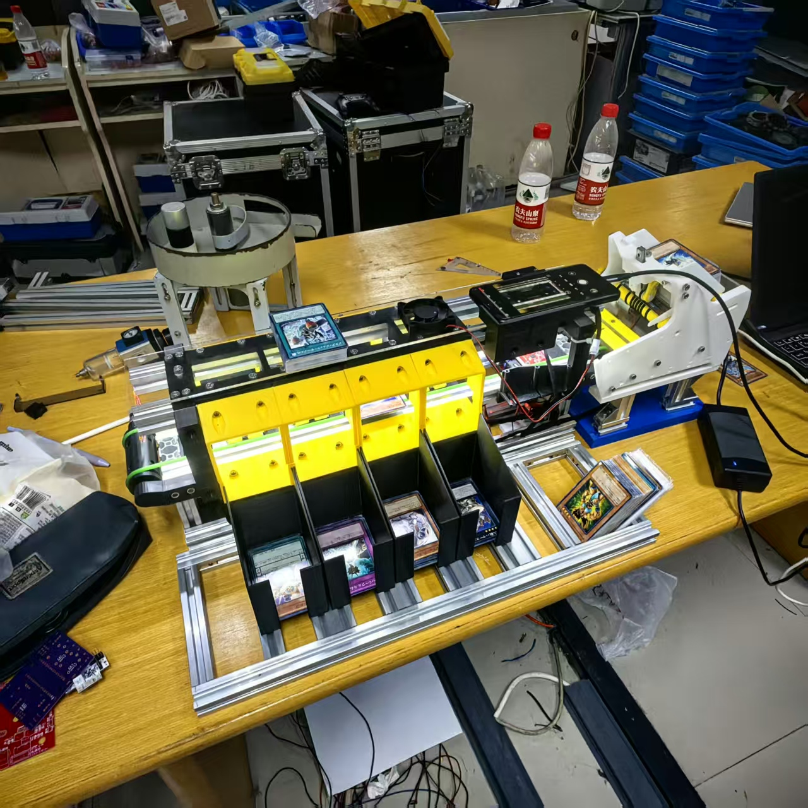
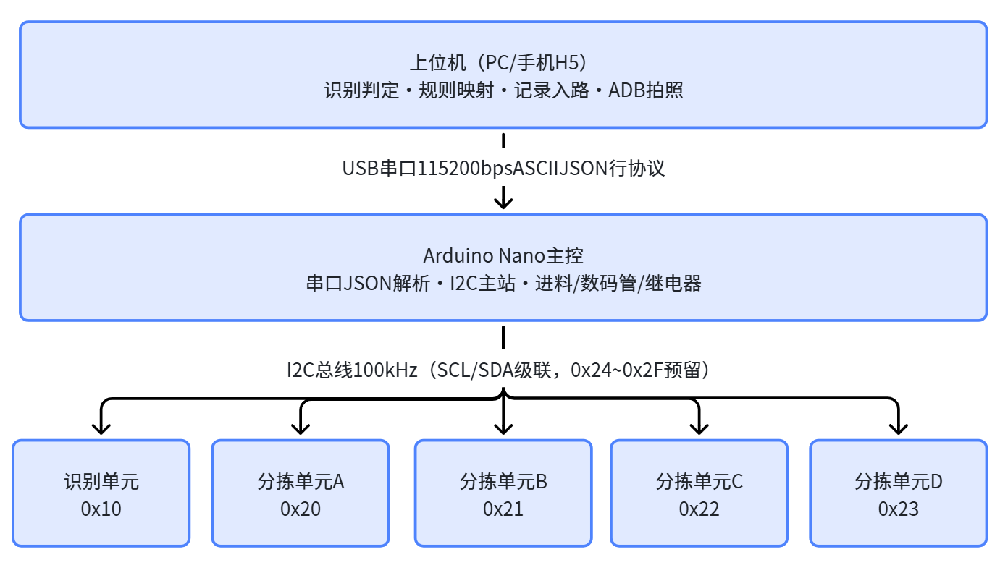
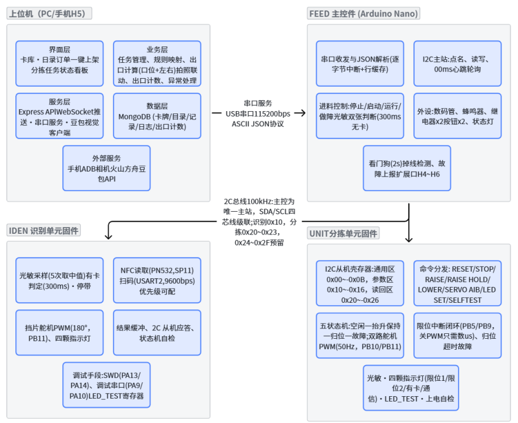

# 卡牌自动分拣机（S-LAN）

> 把一叠集换式卡牌**逐张分开送入**，在识别工位读取卡牌信息（NFC / 条码 / 图像识别），按预设规则**自动分流到 8 个出口**，另有第 9 路兜底通道；识别位置同时用手机**拍照存档**。
> 面向中小体量卡牌店铺的理卡场景：人工逐张核对信息慢、易出错、反复拿取还伤卡。



## 一、这个项目做了什么

**痛点**：卡牌在售卖前要逐张核对信息并归类，人工做既慢又容易错，卡牌反复拿取还会磨损。

**方案**：一套「**上位机决策 → Arduino Nano 主控 → STM32 单元执行**」的三层架构自动分拣设备。业务逻辑（识别判定、走向计算、记录保存）放在上位机便于改动；硬实时动作（电机启停、舵机动作、限位判断）放在单元本地保证时序。

**硬件**：自行设计并打样三块电路板——主控底板、识别单元板、分拣单元板；机架为 2020/2040 铝型材，料仓、滚筒、分拣斜面、舵机限位盒等为 3D 打印件（PLA）。供电为 220V→12V 适配器，经 L298N 板载 78M05 降到 5V，再由 AMS1117-3.3 降到 3.3V 供逻辑电路，逻辑与负载分开供电以避开舵机启动冲击。

**软件**：制定 I²C 寄存器命令格式与串口文本协议，打通三层通信；分拣单元用五状态机并在本地完成限位闭环，识别单元完成停带与多方式识别，主控完成点名、心跳与进料控制；上位机在既有卡牌管理系统上扩展分拣联动服务。

**验证**：单块电路板 15 项功能测试全部通过；识别单元与分拣单元在 I²C 总线上点名正常、连续运行无掉线；送料、识别位停带、识别上报与分口分拣已联调通过，连续 3 张平均 **32.2 秒/张**、分类 3/3 正确。

## 二、关键指标

| 项目 | 数值 |
|---|---|
| 有效出口 | 8 个（4 个分拣单元 × 左右）+ 1 个兜底通道，共 9 路 |
| 控制器 | Arduino Nano（ATmega328P）×1 + STM32F103C8T6 ×5 |
| 通信 | 上位机↔主控：USB 115200bps / WiFi 9600bps；主控↔单元：I²C 50kHz |
| 协议 | ASCII 逗号分隔文本行（**不是 JSON、不是 HTTP**） |
| 分拣执行 | 每口两只 360° 舵机，抬升高度由转动时长决定，限位本地闭环 |
| 节拍 | 连续 3 张 **32.2 秒/张**（单张约 42.8 秒） |
| 整机尺寸 | 约 500 × 80 mm（机架 2020/2040 型材） |

## 三、仓库结构

```
01-硬件/
  ├─ PCB/                三块自制电路板资料（FEED / IDEN / UNIT 原理图、BOM、DXF、网表）
  ├─ 结构3D/             SolidWorks 装配体与零件、STL
  └─ 固件/
      ├─ 01-最终固件/    ★ 三份要烧进板子的最终代码
      └─ 02-迭代记录/    从 01-BoardTest 到 86-FeedFinal 的全部调试版本
02-软件/
  ├─ Device/             Python 设备端（Flask，6001）：主流程、无线链路、拍照、规则
  ├─ Server/             Node 后端（4002）：业务接口、静态页托管、AI 调用
  ├─ Client/             uni-app 前端源码
  └─ Docs/               设计与实测记录
03-说明/
  ├─ 硬件说明.md         三块板 → 各烧哪份固件、怎么验证、I²C 上拉与供电
  ├─ 软件说明.md         目录、端口、启动步骤、配置怎么填、接口分层
  ├─ 使用说明.md         整机怎么跑一遍、参数含义、故障速查
  ├─ 演示视频/           整机演示（46 秒，1280×720）＋ 机构动作短片
  └─ 图片/               实物图与论文插图
```

## 四、三部分与对应文档

| 部分 | 内容 | 文档 |
|---|---|---|
| **硬件** | 三块 PCB + 3D 结构 + 固件 | [硬件说明](03-说明/硬件说明.md) |
| **软件** | 上位机（Python 设备端 + Node 后端 + 前端） | [软件说明](03-说明/软件说明.md) |
| **整机使用** | 送料 → 识别 → 分拣 → 拍照全流程 | [使用说明](03-说明/使用说明.md) |

### 烧固件只看这一张表

| 部件（板） | 主控 | 最终固件 | 注意 |
|---|---|---|---|
| 进料 / 总控（FEED 板） | Arduino Nano | `固件/01-最终固件/87-ZLocal/87-ZLocal.ino` | 里面要填你自己的 WiFi 名/密码/静态 IP |
| 识别单元（IDEN 板，I²C `0x10`） | STM32F103C8T6 | `固件/01-最终固件/57-IdentUnit-FINAL/main.c` | Keil + ST-Link |
| 分拣单元（UNIT 板，I²C `0x20~0x23`） | STM32F103C8T6 ×4 | `固件/01-最终固件/30-SortUnit-V5/main.c` | **改第 13 行 `BOARD_ADDR_7BIT`**，四块填 0x20/0x21/0x22/0x23 |

`02-迭代记录` 里的 01~86 号是当年的测试与调试程序，**别当正式固件烧**。

## 五、系统结构





> 两张示意图来自论文，图中标注的是**早期方案口径**（JSON 行协议、I²C 100kHz）。
> **实际固件实现**是 ASCII 逗号分隔文本帧、I²C **50kHz**（为稳定特意降速），以本 README 与源码为准。

## 六、快速开始（只跑软件）

```bash
# 依赖：Node.js v20/v22 LTS、Python 3.10+、MongoDB
pip install flask flask-cors pyserial

cd 02-软件/Server && npm install && node src/index.js   # 后端 4002
cd 02-软件/Device && python app.py                      # 设备端 6001
# 浏览器打开 http://localhost:4002
```

前端改动后需要自行 `npm run build:h5`（`Client/dist` 不在仓库里）。

## 七、用之前必须自己补的两样

1. **豆包（火山方舟）API Key** —— 图像识别用。仓库**不含任何 Key**；到火山方舟申请后，在系统后台「API Key」里新增一条，模型 `doubao-seed-2-0-mini-260428`。
2. **现场网络参数** —— 固件里的 `WIFI_SSID / WIFI_PASS / ESP_STATIC_IP`，以及 `Device/config.json` 里的 `ESP_IP / PHONE_ADB / PHONE_SERIAL / SAVE_DIR / ADB_PATH` 全是**占位值**，必须按你的现场改。

## 八、版权声明

本项目为作者毕业设计作品，**保留所有权利（All Rights Reserved）**。

仓库公开仅用于学习与展示，**未授予任何使用、修改、分发或商用许可**；如需引用图纸、代码或数据，请先取得作者书面同意。

作者：初晴（ChuQing）
